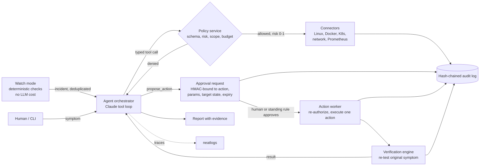

# NightWatch

NightWatch is an AI DevOps agent that you can trust to run when nobody watches.
It monitors your systems. It finds the cause of an incident with evidence.
It changes infrastructure only after an approval that is bound to the exact change.
Then it verifies the result.

Built for [neatHack](https://neatlogs.com/hackathon) (October 2026) with neatlogs, Entire and cfo.ai.

## Why

On-call work at night is repetitive: collect data, compare with a healthy state, find the cause, apply a safe fix, verify.
Plain automation is not safe, because it can change the wrong thing. A plain chat assistant is not useful at 03:00, because nobody is there to type.
NightWatch does the investigation by itself. A deterministic policy gate controls every change.

## How it works



### Investigation engine

The agent follows the method from Brendan Gregg, *Systems Performance* 2e (distilled into [`knowledge/`](knowledge/)):

1. Understand the symptom, scope and time.
2. Discover the resources and the request path.
3. Collect the minimum evidence.
4. List hypotheses with evidence for and against (`update_hypotheses`).
5. Choose the safest test that separates the hypotheses.
6. Diagnose, or say "unknown".
7. Propose a fix with reason, impact, risk, rollback and verification checks.
8. Approval, then execution, then verification happen outside the model.

Rules include: the USE method (errors, saturation, utilization) for every resource; cgroup data inside containers; symptom is not cause; time correlation is not causation; follow the network path and record the last successful step.

### Safety model

| Level | Meaning | Who decides |
|---|---|---|
| 0 | Read-only investigation | Policy: runs automatically |
| 1 | Bounded diagnostic test (DNS, TCP, TLS, HTTP) | Policy: runs automatically |
| 2 | Operational change (restart, start, connect network, rollout undo/restart, scale) | A human, or a standing rule written by a human |
| 3 | Destructive (remove container, delete namespace) | Blocked in v1 |

- The model has no shell. It selects typed tools. Each tool has an input schema, a timeout, an output limit and a target.
- The policy service ([`policy.yaml`](policy.yaml)) checks schema, risk, target scope and budgets outside the model.
- An approval is signed (HMAC) and bound to the action, the parameters, the target's state fingerprint and an expiry. The worker rejects a modified, forged, expired, replayed or stale approval.
- Secrets are redacted from all tool output. Kubernetes secrets show metadata only.
- Tool output is wrapped as untrusted data.
- Every tool call, denial, proposal, approval, execution and verification goes into a hash-chained audit log.

## Quick start

Requirements: Docker Desktop, kind, kubectl, Python 3.10–3.13.

```bash
python3.13 -m venv .venv && source .venv/bin/activate
pip install -e ".[dev]"
cp .env.example .env          # add ANTHROPIC_API_KEY (or the neatHack LiteLLM key + NIGHTWATCH_LLM_BASE_URL) and NEATLOGS_API_KEY
bash lab/compose/up.sh        # Docker lab on http://localhost:8080
bash lab/k8s/up.sh            # kind lab on http://localhost:8081
pytest -q tests               # safety tests, no API key needed
```

Run:

```bash
nightwatch check                                                     # one watch round, no LLM
bash lab/faults/fault.sh redis-down inject                           # break something real
nightwatch investigate "Users get 503 errors on http://localhost:8080"
nightwatch watch                                                     # unattended mode
nightwatch approvals && nightwatch approve <id>                      # in a second terminal
nightwatch audit --verify                                            # check the audit chain
bash lab/reset_all.sh
```

## Evaluation

[`evals/run_evals.py`](evals/run_evals.py) runs known incidents from [`evals/scenarios.yaml`](evals/scenarios.yaml):
reset lab → inject a real fault → investigate → grade → reset.
It measures root-cause accuracy, fix accuracy, resolution, tool calls, time, cost and unauthorized changes (must be 0).
Results are in [`evals/results/`](evals/results/).

## Layout

| Path | Content |
|---|---|
| `nightwatch/agent.py` | Orchestrator (Claude tool loop, neatlogs spans) |
| `nightwatch/policy.py` | Policy and approval service |
| `nightwatch/worker.py` | Action worker and verification engine |
| `nightwatch/audit.py` | Hash-chained audit store |
| `nightwatch/connectors/` | Linux, Docker, Kubernetes, network, monitoring |
| `nightwatch/watch.py` | Watch mode |
| `knowledge/` | Runbooks from *Systems Performance* 2e |
| `lab/` | Fault lab (Docker Compose + kind, 12 faults) |
| `evals/` | Scenarios, harness, results |
| `hackathon.md` | Build log |

## Limitations

See [`hackathon.md`](hackathon.md#known-limitations-and-next-steps).
